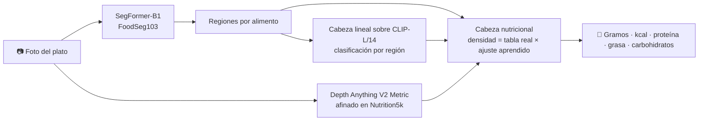

<div align="center">

# 🍽️ Estimador de Calorías por IA

**De una foto de comida a calorías y macronutrientes: segmentación + clasificación + profundidad + estimación nutricional.**


</div>

---

## 📌 Descripción

Proyecto de **Inteligencia Artificial** (Universidad Industrial de Santander) que estima el contenido nutricional de un plato a partir de **una sola imagen**, con énfasis en que el sistema reconozca la **mayor variedad posible de alimentos**, incluida comida casera (arroz, lentejas, etc.), y no solo calorías sino también **proteína, grasa y demás macronutrientes**.

El sistema separa el problema en etapas, cada una con un modelo preentrenado adaptado al dominio:

1. **Segmentar** cada alimento del plato.
2. **Clasificar** qué alimento es cada región (el punto más difícil: arroz y lentejas no pesan lo mismo nutricionalmente).
3. **Estimar la profundidad** para pasar de píxeles a volumen/masa.
4. **Calcular gramos y nutrientes** con una cabeza nutricional y una tabla de valores por alimento.

---

## 🧠 Arquitectura



| Etapa | Modelo | Datos |
|---|---|---|
| Segmentación | SegFormer-B1 (preentrenado en FoodSeg103, sin fine-tuning adicional) | FoodSeg103 |
| Clasificación por región | Cabeza lineal sobre CLIP-L/14, inicializada con el texto de las clases (regularización L2-SP, pesos de clase, 3 semillas) | Nutrition5k autoetiquetado |
| Profundidad | Depth Anything V2 Metric (afinado en Nutrition5k) | Nutrition5k (`realsense_overhead`) |
| Nutrición | Cabeza que combina máscara + profundidad + clase | Nutrition5k (metadata) |

---

## 🏷️ Autoetiquetado de Nutrition5k

Nutrition5k no trae segmentación, así que las etiquetas se generan **automáticamente** (sin anotar a mano):

1. **SegFormer-B1** da la máscara de primer plano (comida vs. fondo).
2. **SAM 2** propone máscaras pixel a pixel.
3. **CLIP** clasifica cada región *restringido a los ingredientes del plato* (tomados de la metadata), con opciones de rechazo.
4. Cada región se filtra por confianza y área; la comida dudosa se marca como `255` (ignorar).

Esquema de etiquetas: `0` = fondo · `1..K` = clase · `255` = ignorar.

---

## 📊 Resultados

Evaluación sobre un **set limpio de 40 platos anotados a mano** (183 regiones), con `tau = 0.3`:

| Clasificador | mIoU (regiones predichas por B1) | acc_px (regiones de referencia) |
|---|:---:|:---:|
| CLIP zero-shot | 0.383 | 0.666 |
| Cabeza lineal — Dataset A (mínimo) | **0.609** | 0.879 |
| Cabeza lineal — Dataset B (estricto) | 0.602 | **0.881** |

> A vs. B no muestran diferencia significativa (bootstrap, IC95 contiene 0).

**Segmentación en FoodSeg103** (mIoU en validación): B0 0.21 → B1 0.27; con la cabeza de clasificación sobre regiones predichas: 0.266 → **0.385**.

**Estimación nutricional:** _(completar con el %MAE final del `Pipeline_final_nutricion.ipynb`)_

---

## 📁 Estructura del repositorio

```
.
├── foodseg103_segmentacion_clasificacion_final.ipynb   # SegFormer-B1 + cabeza de clasificación en FoodSeg103
├── Nutrition5k_autoetiquetado_v2_final.ipynb           # Autoetiquetado v2 (B1 + SAM2 + CLIP)
├── Nutrition5k_etiqueted.ipynb                         # Exploración / revisión de etiquetas
├── Nutrition5k_finetuning_cabeza_clip.ipynb            # Fine-tuning de la cabeza CLIP (datasets A y B)
├── Cabeza_final_nutricion.ipynb                        # Cabeza nutricional (máscara + profundidad + clase)
├── Pipeline_cabeza_nutricion_clip.ipynb                # Pipeline con cabeza CLIP (versión intermedia)
├── Pipeline_completo_nutricion.ipynb                   # Pipeline completo (versión intermedia)
├── Pipeline_final_nutricion.ipynb                      # ⭐ Pipeline final de punta a punta
├── cabeza_clip_{A,B}_s{0,1,2}.pt                       # Pesos de las cabezas CLIP (dataset × semilla)
├── clean_set/ · clean_refs/                            # Set limpio de 40 platos anotados a mano
└── README.md
```

> Las carpetas de datos, cachés, etiquetas masivas y `sam2.1_b.pt` **no** se versionan (ver `.gitignore`).

---

## 🚀 Cómo reproducirlo

### 1. Entorno

```bash
conda create -n autolabel python=3.10 -y
conda activate autolabel
pip install torch torchvision --index-url https://download.pytorch.org/whl/cu128
pip install transformers datasets ultralytics open_clip_torch scikit-learn pandas matplotlib jupyter
```

> Probado con PyTorch 2.x + CUDA 12.8 en una **RTX 5060 (sm_120)**.

### 2. Datos

- **FoodSeg103** — formato Arrow, vía Hugging Face.
- **Nutrition5k** — solo `realsense_overhead/` y `metadata/` (`dish_metadata_cafe1.csv`, `dish_metadata_cafe2.csv`, `ingredients_metadata.csv`).

Ajusta las rutas al inicio de cada notebook según dónde los descargues.

### 3. Pesos

- **SegFormer-B1** entrenado en FoodSeg103 → guárdalo en la ruta que indica el notebook.
- **SAM 2.1 (`sam2.1_b.pt`)** → se descarga automáticamente con `ultralytics` o desde su repositorio oficial.

### 4. Orden sugerido de notebooks

1. `foodseg103_segmentacion_clasificacion_final.ipynb`
2. `Nutrition5k_autoetiquetado_v2_final.ipynb`
3. `Nutrition5k_finetuning_cabeza_clip.ipynb`
4. `Cabeza_final_nutricion.ipynb`
5. `Pipeline_final_nutricion.ipynb`

---

## 🧭 Limitaciones y trabajo futuro

- Clases con IoU ≈ 0 en el set limpio: *sweet potato, pork, fish, tofu* (familias visualmente parecidas).
- Los errores del autoetiquetado se concentran en regiones pequeñas y alimentos similares (carnes, camote/papas asadas, calabazas).
- Desbalance de clases y cobertura de arroz pendientes de diagnóstico.
- Ampliar la variedad de comida colombiana/casera.

---

## 📚 Referencias

- Thames et al., *Nutrition5k: Towards Automatic Nutritional Understanding of Generic Food*, CVPR 2021.
- Wu et al., *A Large-Scale Benchmark for Food Image Segmentation (FoodSeg103)*, ACM MM 2021.
- Xie et al., *SegFormer: Simple and Efficient Design for Semantic Segmentation with Transformers*, NeurIPS 2021.
- Ravi et al., *SAM 2: Segment Anything in Images and Videos*, 2024.
- Radford et al., *Learning Transferable Visual Models From Natural Language Supervision (CLIP)*, ICML 2021.
- Yang et al., *Depth Anything V2*, NeurIPS 2024.

---

## 👥 Equipo

- _Jose David Ramirez Cacua_ — [@usuario](https://github.com/JoseRamirezkqa)
- _María José Correa Ariza_ — [@usuario](https://github.com/MariaJCorrea)
- _Miguel Pardo_ — 

Universidad Industrial de Santander · Ingeniería de Sistemas · Inteligencia Artificial

## 📄 Licencia

_Define aquí la licencia (por ejemplo MIT). Ten en cuenta las licencias de los datasets y modelos usados._
